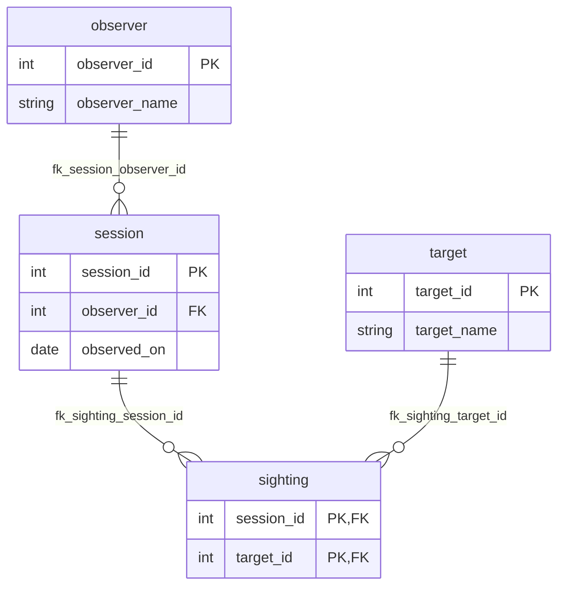

# CMSC 127 Lab Starter

Your pair writes database code in this repository. Start Lab 1 by adding your schema to `migrations/`, adding your data to `load.sql`, and running `./check.sh 1`. The instructor grades the files that differ from the published starter. The published cases, the manifest, and the runner wiring stay unchanged.

## Set Up on Windows

Install Git, Python 3.15 or newer, PostgreSQL, and Node.js. Install npm with Node.js. Start the PostgreSQL server before you run the checks.

In Git Bash on Windows, create the environment, install the Python packages, and install Pyright:

```bash
python -m venv .venv
source .venv/Scripts/activate
python -m pip install -r requirements.txt
npm install --global pyright@1.1.414
```

Set `CMSC127_DATABASE_URL` in your shell. Use a local role that can create and drop databases. The runner creates a separate database for each run, so your working data stays unchanged.

```bash
export CMSC127_DATABASE_URL='postgresql://your_user@127.0.0.1:5432/your_database'
```

Add a password to the URL only in your local shell when your server needs one. Do not save a password in this repository.

## Set Up on macOS and Linux

Use the same steps with the Unix activation path:

```bash
python3 -m venv .venv
source .venv/bin/activate
python -m pip install -r requirements.txt
npm install --global pyright@1.1.414
export CMSC127_DATABASE_URL='postgresql://your_user@127.0.0.1:5432/your_database'
```

## Run the Checks

Run stage 1 with `./check.sh 1`. Run stage 2 with `./check.sh 2`. Stage 2 includes stage 1, so a failure in Lab 1 still fails during Lab 2.

The first run downloads the pinned runner. Later runs use the local copy and need no network.

The runner prints one line for each case and each invariant check. It ends with a count line. A failed check exits with a nonzero status.

### Run One Case

`./check.sh --case lab1/health` runs one case. Use it while you debug one query. The command still creates a scratch database and applies your migrations. It exits 0 when the case passes, 1 when it fails, and 2 for a form fault or a usage error.

### Check the Form Without a Database

`./check.sh --form-lint` checks the manifest and the case files. It needs no database and prints no expected answer. It exits 0 when the form is valid and 2 when it is not.

### Test the Runner

`./check.sh --self-test` tests the runner itself. It uses a separate scratch database and does not check your schema. The activity result stays in `.cmsc127/last-run.json`.

## Migrations and Data

Put schema changes in `migrations/`. Name each file `NNNN_lowercase_description.sql`, such as `0001_create_observer.sql`. Start at `0001` and do not skip a number. The runner applies the files in filename order to a new database. A missing number stops the run, because the runner cannot tell whether the missing file changes the schema.

Put the data loader in `load.sql`. The runner calls `./run prepare` after it applies the migrations. The command runs this SQL file without changing your source files.

`./run` is the pair command. The runner calls `./run prepare`, `./run backup`, `./run restore`, or `./run path/to/query.sql`. The connection helper runs one SQL file and prints its columns and rows as JSON.

## Cases and Results

The runner reads `cases/manifest.json`. The manifest is a JSON file that lists each case, its stage, its group, and its kind. Each case needs an `.expected` JSON file beside it. An optional `.exit` file holds the expected exit status. Every case file must appear in the manifest.

Add your own cases in `cases/pair/manifest.json`. Use the same fields, and keep the files inside `cases/pair/`. The published manifest stays unchanged, so the protected-file check still passes.

A minimal case entry:

```json
{"id": "lab1/observers", "stage": 1, "kind": "query", "file": "cases/lab1/observers.sql"}
```

The case file holds one SQL statement or one command. The expected file holds a `columns` list and a `rows` list:

```json
{"columns": ["observer_id", "observer_name"], "rows": [[1, "Ada"], [2, null]]}
```

The runner compares the result with that object. Use JSON `null` for SQL `NULL`. Numbers compare by value, so `1`, `1.0`, and `1.00` match. Column names and their order always match. Row order matches by default. Set `ordered` to `false` when the result has no required row order. The runner compares duplicate rows too.

The six case kinds are `output`, `schema`, `reject`, `state`, `race`, and `query`. An `output` case compares the JSON from `./run`. A `schema` case compares the ERD with the live schema. A `reject` case requires SQL to fail. A `state` case checks the rows after an operation. A `race` case runs ordered steps on two sessions. A `query` case runs a SQL file directly.

A skipped check prints `SKIP` with a reason. A skip does not count as a pass. A form fault stops the run before it creates a database. It reports the file, line, and column, and exits with status 2. The form check covers the manifest, each expected result, each state or race body, and each invariant's required fields.

The result file `.cmsc127/last-run.json` holds the case results. It is not the same as an `.expected` file. The expected file holds one dataset. The result file wraps every case result, with its status, expected value, actual value, and differences.

## Invariant Checks

After the cases, the runner checks claims that a case cannot show. A normal-form rule says that one column determines another, such as a supplier determines its city. The runner reads the catalog, PostgreSQL's own description of the tables, and confirms that a key enforces each rule. It also checks that each report ran as SQL, that a view contains a required construct, that a migration created the required index, that a backup restores the same rows, that the protected files match, that the written sections have content, and that your Python passes strict type checking. It prints a contribution table with commits and changed lines by member and week. The table is information for the instructor and adds no score.

The runner prints each result, a count for each group, and one final count:

```text
PASS lab1/observers
FAIL lab2/summary
  row 1 differs: expected [3], actual [4]
SKIP lab3/race: this platform cannot run two sessions
== result ==
1/2 checks passed, 1 failed, 1 skipped; Pyright: 0 errors
```

A `PASS` line means the result matched. A `FAIL` line shows the difference and the expected and actual values. A `SKIP` line gives a reason and does not enter the count. The `Pyright` part of the count line reports the type-check result.

## Write the ERD

An entity-relationship diagram (ERD) shows tables and their relationships. Edit the ERD block in this README to match your schema. The runner compares table names, column names, primary keys, foreign keys, and relationship endpoints.


